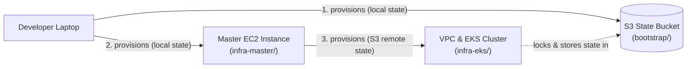
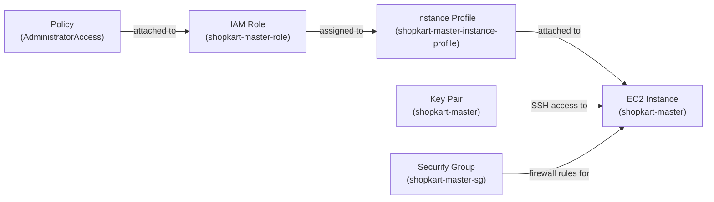
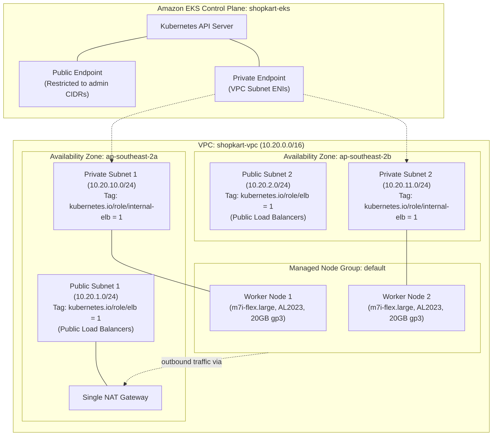

# ShopKart Infrastructure

Terraform infrastructure for the ShopKart project in AWS region `ap-southeast-2` (Sydney). It provisions:
- An S3 bucket for Terraform remote state (`bootstrap/`).
- A dedicated CI/CD "master" EC2 instance hosting Jenkins, SonarQube, Docker, and deployment CLIs (`infra-master/`).
- A dedicated VPC and Amazon EKS Kubernetes cluster for application workloads (`infra-eks/`).

---

## ShopKart Project Map

| Repo | What it holds | Changed by |
|---|---|---|
| [shopkart-app](https://github.com/vkashsingh/shopkart-app) | App source code (React, Node.js), Dockerfiles, compose files, and Jenkinsfile | Developers |
| [shopkart-infra](https://github.com/vkashsingh/shopkart-infra) | Terraform: state bucket, Jenkins master EC2, VPC, EKS cluster | DevOps |
| [shopkart-gitops](https://github.com/vkashsingh/shopkart-gitops) | Kubernetes manifests, Helm charts, and Argo CD Application definitions | Jenkins (image tag), Argo CD (sync) |

**Flow:** push to `shopkart-app` → Jenkins runs tests, SonarQube quality analysis, Trivy scans, Docker build, and pushes images → Jenkins updates image tag in `shopkart-gitops` → Argo CD syncs manifests to EKS → Prometheus and Grafana monitor workloads.

**You are here: shopkart-infra**

---

## Overview Diagram



---

## Folders

| Folder | Creates | Run from | State |
|---|---|---|---|
| `bootstrap/` | S3 remote state bucket with versioning, SSE-S3 encryption, and public access block | Laptop | Local state (`terraform.tfstate`) |
| `infra-master/` | Ubuntu 24.04 EC2 instance running Jenkins, SonarQube, Docker, and DevOps tooling | Laptop | Local state (`terraform.tfstate`) |
| `infra-eks/` | VPC (2 AZs, public and private subnets, NAT GW) and EKS cluster with managed nodes and add-ons | Master EC2 | S3 remote state with `use_lockfile = true` |

---

## infra-master

### Architecture



### Resources

| Resource Address | Purpose |
|---|---|
| `data.aws_vpc.default` | Discovers the AWS default VPC in the region for placing the security group. |
| `data.aws_subnets.default` | Queries subnets in the default VPC to select host subnet placement. |
| `data.aws_ami.ubuntu_24_04` | Discovers the latest official Ubuntu 24.04 LTS Noble 64-bit server AMI. |
| `aws_key_pair.master` | Imports the developer SSH public key into EC2 for authorized shell login. |
| `aws_security_group.master` | Restricts ports 22 (SSH), 8080 (Jenkins), and 9000 (SonarQube) to `<your-ip>/32`. |
| `aws_iam_role.master` | IAM service role assumed by the EC2 instance via STS. |
| `aws_iam_role_policy_attachment.master_admin` | Attaches `AdministratorAccess` so Terraform on the master can manage AWS resources. |
| `aws_iam_instance_profile.master` | Wraps the IAM role so the EC2 instance metadata service can supply STS credentials. |
| `aws_instance.master` | Deploys the Ubuntu 24.04 EC2 instance (`m7i-flex.large`, 30 GB gp3, IMDSv2, user-data). |

### User-Data Bootstrap Tooling

When `aws_instance.master` launches, `scripts/user-data.sh` installs and configures:

| Tool / Package | Source | Purpose |
|---|---|---|
| **Base utilities** | Ubuntu APT (`curl`, `git`, `jq`, `unzip`, `ca-certificates`) | Foundation utilities for executing bootstrap steps and installer scripts. |
| **Java 21** | OpenJDK 21 (`openjdk-21-jdk`) | Required runtime for running the Jenkins LTS daemon. |
| **Jenkins LTS** | Jenkins official Debian repository | Core automation server running CI/CD pipelines on port 8080. |
| **Docker Engine** | Docker official APT repository | Container runtime; adds `ubuntu` and `jenkins` users to `docker` group. |
| **SonarQube & PostgreSQL** | Docker Compose (`sonarqube:26.8.0.126808-community`, `postgres:17`) | Static code analysis platform on port 9000 with PostgreSQL backend. |
| **AWS CLI v2** | AWS official binary installer | AWS CLI for automated interaction with AWS APIs and EKS clusters. |
| **Terraform** | HashiCorp official APT repository | Infrastructure as Code CLI used on the master to provision `infra-eks`. |
| **kubectl** | Kubernetes official upstream stable binary | Command-line tool for inspecting and managing Kubernetes workloads. |
| **Helm 3** | Buildkite Debian package repository | Kubernetes package manager for installing charts and operators. |
| **Trivy** | Aqua Security official APT repository | Vulnerability scanner for container images, filesystems, and git repos. |
| **yq** | Mike Farah official GitHub release binary | Command-line YAML processor for pipeline manifest automation. |

---

## infra-eks

### Architecture



### EKS Add-ons

| Add-on | Configuration | Why it exists |
|---|---|---|
| **eks-pod-identity-agent** | `most_recent = true`, `before_compute = true` | Runs the node daemon that enables Kubernetes pods to assume AWS IAM roles directly without OIDC. Must start before compute workloads run. |
| **vpc-cni** | `most_recent = true`, `before_compute = true` | Assigns native AWS VPC IP addresses directly to Kubernetes pods. Must initialize before compute nodes schedule pods. |
| **coredns** | `most_recent = true` | Provides internal Kubernetes cluster DNS service discovery for pods and services. |
| **kube-proxy** | `most_recent = true` | Maintains network routing rules on worker nodes to route traffic to Service backends. |
| **aws-ebs-csi-driver** | `most_recent = true`, `pod_identity_association` | Manages lifecycle of AWS EBS volumes used by PersistentVolumeClaims (PVCs). |

> [!NOTE]
> **Why Pod Identity instead of IRSA**: This AWS account has an SCP (Service Control Policy) that blocks creating IAM OIDC identity providers (`iam:CreateOpenIDConnectProvider`). EKS Pod Identity bypasses this limitation by routing STS assume-role calls through the in-cluster agent and the `pods.eks.amazonaws.com` service principal without needing an OIDC provider.

---

## How to Apply, in Order

### Step 1: Provision Bootstrap State Storage
Run from your local laptop:
```bash
cd bootstrap
terraform init
terraform apply
```
Note the bucket name output (e.g., `shopkart-tfstate-<account_id>`).

### Step 2: Provision Master Machine
Run from your local laptop:
```bash
cd ../infra-master
cp terraform.tfvars.example terraform.tfvars
# Set my_ip = "<your-ip>/32"
terraform init
terraform apply
```
Wait 5 to 10 minutes after apply finishes for the `user-data.sh` script to complete.

### Step 3: Provision VPC and EKS Cluster
Connect to the master EC2 instance via SSH:
```bash
ssh -i ~/.ssh/shopkart-master ubuntu@<master-public-ip>
```
Run inside `tmux` so network disconnects do not abort the 15-20 minute run:
```bash
tmux new -s eks-deploy
cd ~
git clone https://github.com/vkashsingh/shopkart-infra.git
cd shopkart-infra/infra-eks
cp terraform.tfvars.example terraform.tfvars
# Set admin_cidrs = ["<your-ip>/32"] and extra_admin_arn = "<admin-role-arn>"
terraform init -backend-config="bucket=<state-bucket>"
terraform plan -out tfplan
terraform apply tfplan
```

### Step 4: Configure Kubeconfig & StorageClass
Run from the master EC2 instance:
```bash
aws eks update-kubeconfig --region ap-southeast-2 --name shopkart-eks
kubectl apply -f k8s/storageclass-gp3.yaml
kubectl annotate storageclass gp2 storageclass.kubernetes.io/is-default-class-
```

---

## How to Verify Each Part

### Verify Bootstrap
```bash
aws s3 ls | grep shopkart-tfstate
aws s3api get-bucket-versioning --bucket <state-bucket>
aws s3api get-bucket-encryption --bucket <state-bucket>
aws s3api get-public-access-block --bucket <state-bucket>
```

### Verify infra-master
```bash
ssh -i ~/.ssh/shopkart-master ubuntu@<master-public-ip>
tail -n 20 /var/log/user-data.log
cat /var/log/bootstrap-done
java -version
jenkins --version
docker ps
curl -I http://localhost:8080
curl -I http://localhost:9000
aws --version
terraform version
kubectl version --client
helm version
trivy --version
yq --version
```

### Verify infra-eks
```bash
aws eks describe-cluster --region ap-southeast-2 --name shopkart-eks --query "cluster.status"
kubectl get nodes -o wide
kubectl get pods -A
kubectl get sc
kubectl get csidrivers
```

---

## Destroy Order and Costs

### Destroy Order

1. **Delete Kubernetes Load Balancers and PVCs first**:
   ```bash
   kubectl delete svc --all-namespaces --selector=app.kubernetes.io/managed-by!=Helm
   kubectl delete pvc --all-namespaces --all
   ```
   Wait until all AWS Elastic Load Balancers and EBS volumes are released.

2. **Destroy infra-eks**:
   ```bash
   cd infra-eks
   terraform destroy
   ```

3. **Destroy infra-master**:
   ```bash
   cd ../infra-master
   terraform destroy
   ```

4. **(Optional) Destroy bootstrap state bucket**:
   ```bash
   aws s3 rm s3://<state-bucket> --recursive
   cd ../bootstrap
   terraform destroy
   ```

### Estimated Monthly Cost Table (`ap-southeast-2` Sydney)

| Resource | Specification | Pricing Model | Approx. Monthly Cost (USD) |
|---|---|---|---|
| **Master EC2 Host** | 1x `m7i-flex.large` (2 vCPU, 8 GiB RAM) | ~\$0.1075 / hour | ~\$77.40 |
| **Master Root Disk** | 30 GB `gp3` SSD | \$0.096 / GB-month | ~\$2.88 |
| **EKS Control Plane** | 1 cluster (`shopkart-eks`) | \$0.10 / hour | \$73.00 |
| **EKS Worker Nodes** | 2x `m7i-flex.large` (2 vCPU, 8 GiB RAM) | ~\$0.1075 / hour each | ~\$154.80 |
| **EKS Node Disks** | 2x 20 GB `gp3` root volumes | \$0.096 / GB-month | ~\$3.84 |
| **VPC NAT Gateway** | 1 Single NAT Gateway (lab) | \$0.059 / hour + data transfer | ~\$42.50 |
| **S3 Remote State** | State objects + versioning | Standard storage and requests | < \$0.50 |
| **Total Lab Baseline** | **Master host + 2-node EKS cluster** | **~ \$11.80 / day** | **~ \$354.92 / month** |

---

## Never Committed

The following files are sensitive or machine-generated and must never be committed to git:

- `terraform.tfvars`: Contains local IP addresses, IAM ARNs, and environment values.
- `*.tfstate` and `*.tfstate.backup`: Contains sensitive infrastructure state and resource IDs.
- `tfplan`: Binary execution plans containing environment configuration and state.
- `.terraform/`: Local working directory containing downloaded provider plugins and modules.
