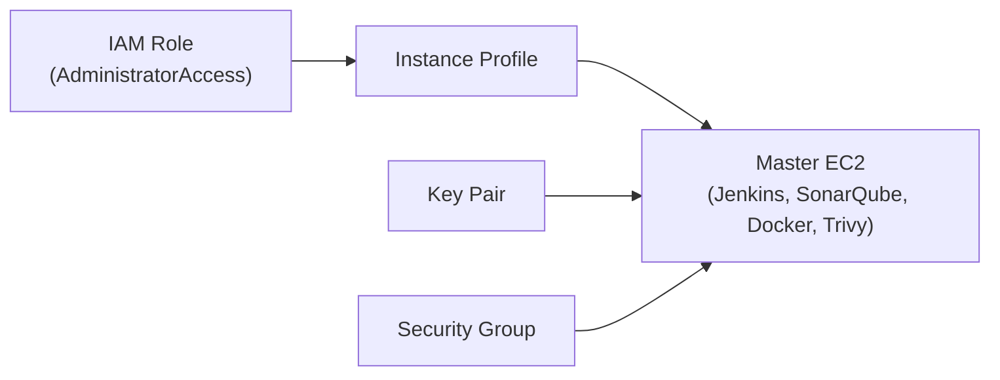
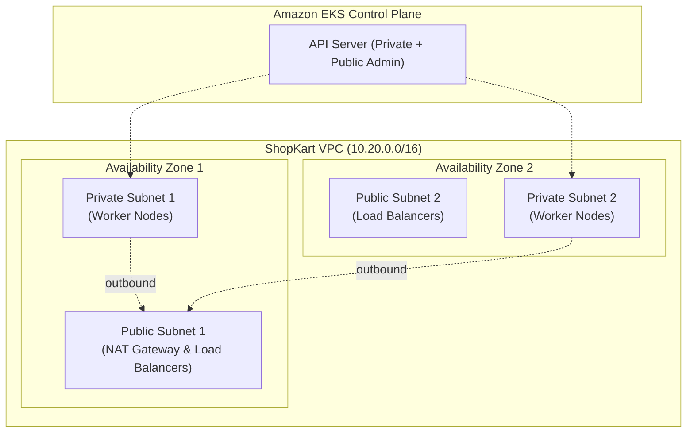

# ShopKart Infrastructure

Terraform infrastructure for the ShopKart project in AWS region `ap-southeast-2` (Sydney). It provisions a Jenkins and SonarQube master EC2 instance and a multi-AZ Amazon EKS cluster, with Terraform remote state stored in S3.

## Project Map

| Repo | What it holds | Changed by |
|---|---|---|
| [shopkart-app](https://github.com/vkashsingh/shopkart-app) | App source (React, Node.js), Dockerfiles, compose, Jenkinsfile | Developers |
| [shopkart-infra](https://github.com/vkashsingh/shopkart-infra) | Terraform: state bucket, Jenkins master EC2, VPC, EKS cluster | DevOps |
| [shopkart-gitops](https://github.com/vkashsingh/shopkart-gitops) | Plain Kubernetes YAML + Argo CD Application | Jenkins, Argo CD |

You are here: `shopkart-infra`

## Folders

| Folder | What it creates | Run from |
|---|---|---|
| `bootstrap/` | S3 remote state bucket with versioning and encryption | Laptop (local state) |
| `infra-master/` | Ubuntu 24.04 EC2 with Jenkins, SonarQube, Docker, and DevOps tooling | Laptop (local state) |
| `infra-eks/` | VPC (2 AZs) and EKS cluster with managed node group and add-ons | Master EC2 (S3 state) |

## infra-master

The master EC2 runs on Ubuntu 24.04 with an attached instance profile for AWS administration. Security group rules restrict SSH, Jenkins, and SonarQube access to your IP address.

## infra-eks

The VPC spans 2 Availability Zones with public subnets hosting the NAT gateway and load balancers, and private subnets hosting the managed worker nodes. The EKS control plane connects to the private subnets and exposes endpoints for internal communication and authorized administrative access.

## Apply Order

Apply `bootstrap/` first from your laptop, then `infra-master/` from your laptop, and finally `infra-eks/` from the master EC2.
